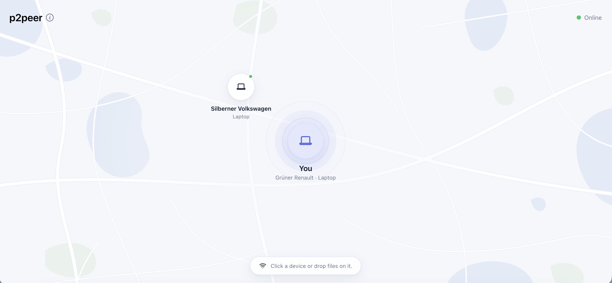
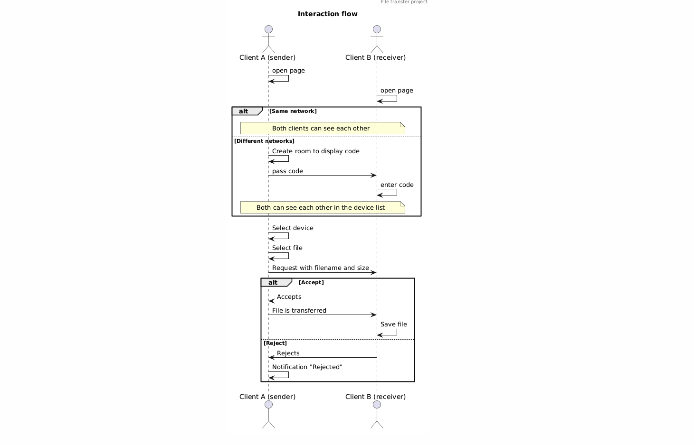

# p2peer - file transfer via same network



A browser-based tool for transferring files directly between devices on the same network. When multiple devices open the application, they automatically discover each other and appear with a generated name and device type.

Files are never uploaded to an external server. Instead, a lightweight Spring Boot signaling server handles the initial handshake, allowing browsers to establish a direct WebRTC connection and transfer files peer-to-peer.

No account or manual pairing required.

## Architecture

The backend is a small Spring Boot app, used only as a **signaling server**. It introduces peers to each other and relays the WebRTC handshake, then steps out of the way.

| Component                | Responsibility                                                                            |
| ------------------------ | ----------------------------------------------------------------------------------------- |
| `WebSocketConfiguration` | Registers the WebSocket endpoint                                                          |
| `WebSocketInterceptor`   | Reads the client IP and the device kind from the User-Agent during the handshake          |
| `RoomRegistry`           | Groups peers into rooms by network, assigns readable names and keeps everything in memory |
| `SignalingHandler`       | Sends several ObjectNodes and relays `signal` messages between peers in the same room     |

**Rooms:** peers with the same network end up in the same room. The strategy is set via `room.strategy` in `application.properties` (You might want to change the strategy if testing out locally)

Signals are only relayed inside one room, so knowing a peer's id is not enough to reach it. That means there is no database, no state on disk - when the last peer leaves, the room will be gone.

## How it works

The complete interaction flow is illustrated in the following sequence diagram. It shows how devices within the same network can be detected automatically. If automatic device discovery is not possible, users can still create and join rooms manually.



## Tech Stack

- Java
- Spring Boot
- Spring WebSocket
- React
- TypeScript

## Getting started

Requirements: Java 21+, Node.js

```bash
# backend
cd server
./mvnw spring-boot:run

# frontend
cd client
npm install
npm run dev -- --host
```

Open the frontend on two devices in the same network. The client connects to `ws://<host>:8080/ws` by default; override it with `VITE_SIGNALING_URL`.

## Future improvements

- a list of future features is about to follow up...
